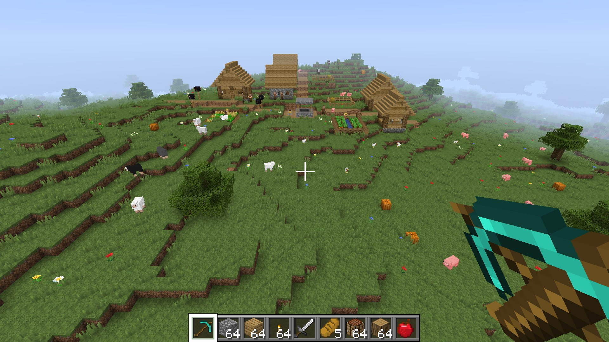
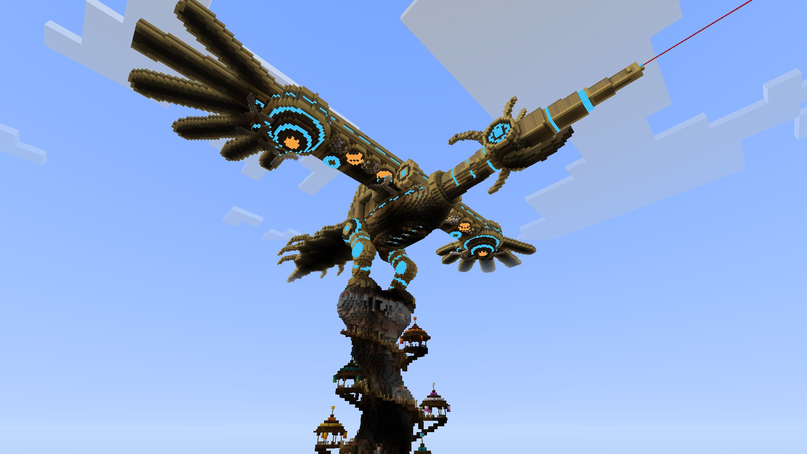
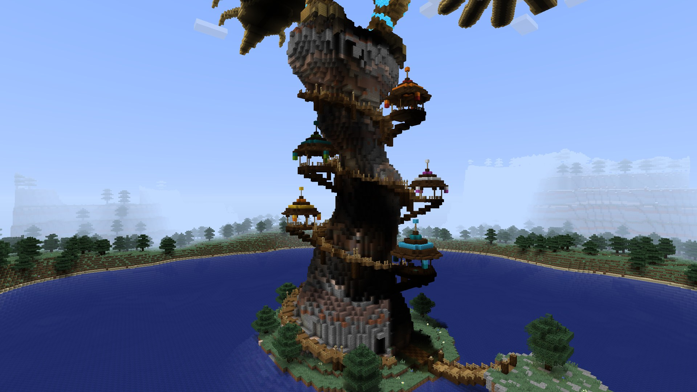
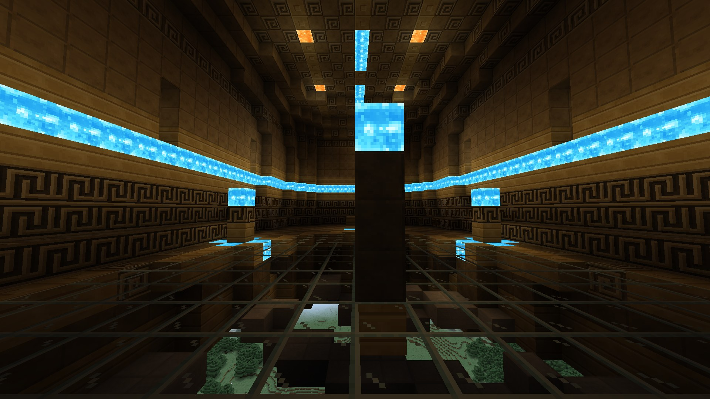

# Minecraft Web Edition

An unofficial, fan-made Minecraft clone that fits in **one HTML file**. There is nothing to install and nothing to download besides that file: every texture, sound and piece of music is generated by code when the page loads.

**▶ Play now:** https://kkecaom.github.io/minecraft-web/

**⬇ Download (1.5 MB):** [minecraft.html](https://github.com/kkecaom/minecraft-web/releases/latest/download/minecraft.html) — save it, double-click it, play. It works offline.

You need a desktop browser with WebGL2 (Chrome, Edge, Firefox or Safari), a keyboard and a mouse.



## What is in the game

- **Survival and Creative** modes: hunger, health, armor, XP, tool tiers and durability
- **Crafting** (2x2 and 3x3), furnaces, chests, beds, buckets, signs
- **21 biomes** with caves, ore veins, dungeons, flowing water and lava
- **Mobs with AI**: pigs, cows, sheep, chickens (with breeding), wolves you can tame, squid, zombies, skeletons, creepers, spiders, endermen, slimes, bats
- **Villages**: villagers with professions, daily schedules and trading, iron golems
- **The Nether**: build a portal, explore the biomes and fortresses
- **The End**: find a stronghold, fight the Ender Dragon, watch the credits
- Day and night with moon phases, rain, snow and thunderstorms
- Advancements, chat commands (`/gamemode`, `/time`, `/tp`, `/give`, `/locate`, `/dimension`, ...)
- Worlds are saved in your browser

Not in the game: redstone, boats and minecarts, multiplayer, enchanting, brewing.

### Featured world: Divine Beast Vah Medoh

The world list comes with a hand-sculpted world you can fly around and walk inside.





## Controls

| Key | Action |
| --- | --- |
| `W` `A` `S` `D` | Move |
| Mouse | Look |
| Left click | Break a block, attack |
| Right click | Place a block, use an item |
| `Space` | Jump (double-tap to fly in Creative) |
| `Shift` | Sneak |
| `Ctrl` | Sprint |
| `1`-`9`, mouse wheel | Pick a hotbar slot |
| `E` | Inventory |
| `Q` | Drop item |
| `T` | Chat, `/` for commands |
| `F1` / `F2` / `F3` / `F5` | Hide HUD / screenshot / debug screen / change camera |
| `Esc` | Pause menu |

Click the game once to capture the mouse. Sound starts on the first click.

## About saves

Worlds are stored in the browser (IndexedDB) for the page you play on, so the online version and a downloaded copy keep separate worlds. Clearing the site data of your browser deletes them.

## Build from source

The game is assembled from the files in `src/` by a small Node.js script with no dependencies:

```bash
node tools/build.js --release
```

This writes `minecraft.html`. The architecture is described in [src/DESIGN.md](src/DESIGN.md).

## 中文说明

这是一个只有一个 HTML 文件的网页版“我的世界”同人作品，所有贴图、音效和音乐都由代码生成。

- 在线玩：https://kkecaom.github.io/minecraft-web/
- 下载：[minecraft.html](https://github.com/kkecaom/minecraft-web/releases/latest/download/minecraft.html)，下载后双击即可离线游玩
- 需要电脑浏览器（Chrome / Edge / Firefox / Safari）、键盘和鼠标
- 操作：WASD 移动，鼠标左键挖掘，右键放置，E 打开背包，空格跳跃（创造模式双击飞行），T 聊天

## Credits and disclaimer

The code, textures and sounds were written by Claude (Anthropic's AI model), directed by [@kkecaom](https://github.com/kkecaom).

This is an unofficial fan project. It is not affiliated with or endorsed by Mojang Studios or Microsoft, and it contains no code or assets from Minecraft. "Minecraft" is a trademark of Mojang Studios. The Vah Medoh world is a fan tribute to *The Legend of Zelda: Breath of the Wild* and is not affiliated with Nintendo.
